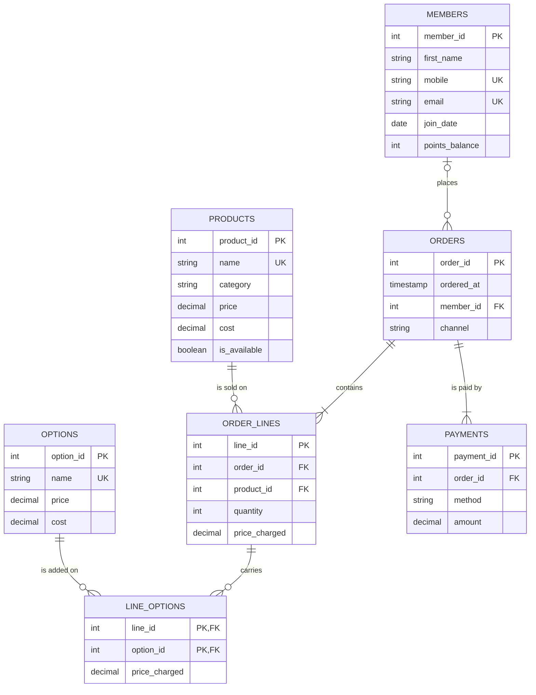

# Babson Bean Café Database

## The Scenario

I chose **scenario C, Babson Bean Café**. Babson Bean is a café on campus. Its till records sales and its loyalty program lives on punch cards, so neither can answer a question. The café wants to know what sells, which add ons earn their keep, and who its regular customers are.

Today the café keeps loyalty members, a menu, add ons a drink can carry (options), orders made of lines, options on lines, and payments. Customers who are not members buy too, and their orders name no member. An order can be paid in more than one payment, part by card and part with points, and a payment can be in dollars from points. The café's revenue is what its lines and their options were charged, however the order was paid.

The question for the project is the one in the scenario: what sells, which options earn their keep, and who are the regulars. The as_of date is **2026-11-07**, and the data covers the 12 months up to it.

## The ERD

How to read the relationship ends:

- A member places zero or more orders. An order is placed by zero or one member, because customers who are not members buy too.
- An order contains one or more lines, and a line belongs to exactly one order.
- A product is sold on zero or more lines, and a line is for exactly one product.
- A line carries zero or more options, and an option is added on zero or more lines. `LINE_OPTIONS` is the table that pairs them up, with the price charged as a fact of its own.
- An order is paid by one or more payments, and a payment belongs to exactly one order.

## What One Row Means

- One row of `members` is one loyalty member, with the mobile number and points balance they have today.
- One row of `products` is one item on the menu, with its current price and cost and whether it is available today.
- One row of `options` is one add on a drink can carry, such as oat milk, with its current price and cost.
- One row of `orders` is one order placed at a date and time, through the counter or the app, by one member or by nobody.
- One row of `order_lines` is one product on one order, in a quantity, at the price charged that day.
- One row of `line_options` is one option on one order line, at the price charged that day.
- One row of `payments` is one payment toward one order, by one method, for an amount in dollars.

## Design Choices
